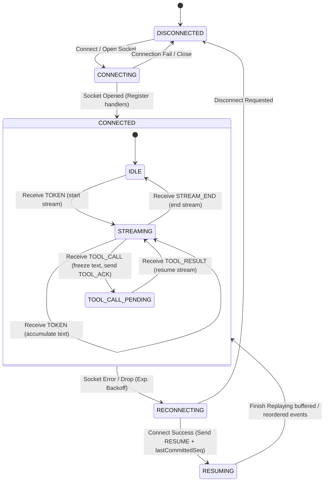

# Agent Console

An interactive, chaos-resilient **Agent Console** built with Next.js 14+ and TypeScript. It connects to an AI agent backend over WebSockets, renders streaming responses and nested tool calls in real-time, displays an expandable trace timeline, parses context snapshots with automatic JSON diffs, and recovers gracefully from simulated network dropouts and message reordering.

---

## Architectural Approach

Our implementation treats real-time AI interfaces as a distributed systems problem with a render loop attached. We separate low-level network management (`WebSocketManager`) and packet processing (`SequenceBuffer`) from the UI layer. By routing all reordered and deduplicated events into atomic, reactive Zustand state stores (`agentStore`, `contextStore`, `timelineStore`), the user interface remains deterministic, layout-shift free, and fully consistent even under severe connection chaos.

---

## WebSocket & Protocol State Machine



---

## Installation & Getting Started

Follow these steps to run both the Agent Server and Agent Console locally.

### 1. Run the Agent Server

You can run the server using Docker or locally:

**Local Method**:
```bash
cd agent-server
npm install
npm run build
npm start                     # Normal Mode
# OR
npm start -- --mode chaos     # Chaos Mode
```

The server runs at `ws://localhost:4747/ws`.

### 2. Run the Agent Console (Frontend)

Open a new terminal window:
```bash
cd agent-console
npm install
npm run dev
```

Open [http://localhost:3001](http://localhost:3001) in your browser.

---

## Verification & Tests

To run the logic unit tests (Sequence Buffer reordering, JSON diffing engine, and Token Batcher):
```bash
cd agent-console
npx vitest run
```

---

## UI Screenshots

Below are captures of the key interfaces of the console:

### A. Streamed Response with Tool Call Interruptions


### B. Collapsible Trace Timeline


### C. Context Inspector with Live JSON Diff

